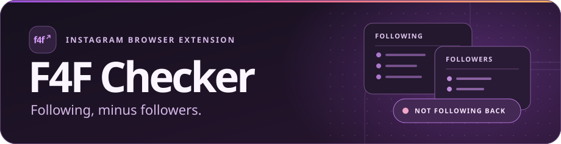
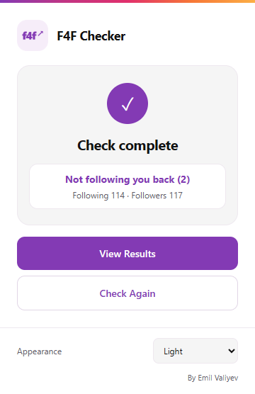
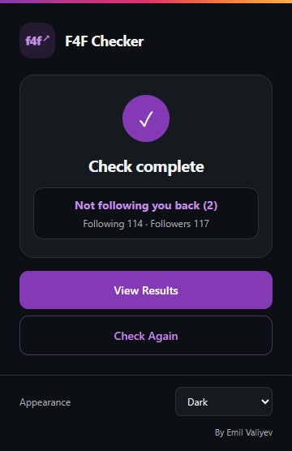

<h1 align="center">
  
</h1>

<p align="center">
  <strong>See which accounts you follow on Instagram don’t follow you back.</strong><br>
  The comparison runs in your browser. No password sharing. No automatic unfollows.
</p>

<p align="center">
  <a href="#install"><strong>Set up in Chrome</strong></a>
  &nbsp;·&nbsp; <a href="https://microsoftedge.microsoft.com/addons/detail/f4f-checker/nkkjgaclfdeidnccmjiemcjdmeooobfj">Edge Add-ons</a>
  &nbsp;·&nbsp; <a href="https://github.com/emillvl/insta-not-following-back/releases/tag/v1.1.0">What’s new in 1.1.0</a>
</p>

<p align="center">
  
  &nbsp;
  
</p>

## Install

**Chrome 112 or later.** Download and unzip the source from the
[1.1.0 release](https://github.com/emillvl/insta-not-following-back/releases/tag/v1.1.0),
or clone this repository. Open `chrome://extensions`, turn on **Developer mode**,
and choose **Load unpacked**. Select the [`extension` folder](extension/).
You don’t need Node.js or a build step to install it.

**Microsoft Edge.** [Get F4F Checker from Edge Add-ons](https://microsoftedge.microsoft.com/addons/detail/f4f-checker/nkkjgaclfdeidnccmjiemcjdmeooobfj).
The instructions and screenshots here describe the GitHub 1.1.0 release.

> Updating an unpacked copy? Click **Reload** on its extension card, then
> refresh your Instagram tab.

## Run a check

1. Open F4F Checker and click **Start Checking**.
2. Sign in on Instagram if prompted. F4F Checker opens your profile and reads
   both lists. Keep the Instagram tab active, even if you close the popup.
3. Read the results on Instagram, or reopen the popup and click **View Results**.
   Each account links to its profile. **Check Again** starts a new scan.

Choose **Light**, **Dark**, or **System** under **Appearance**. Your choice is
remembered between browser sessions.

## A short list isn’t a result

Instagram doesn’t always load every account on the first pass. In 1.1.0, F4F
Checker can revisit a stalled list and cross-check missing accounts. It
only shows a comparison after both lists settle and meet the counts on your
profile. If a list stays short, you’ll see an incomplete scan, not a partial
comparison. A completed check with zero results means
no missing follow-backs were found.

| If you see… | What to do |
| --- | --- |
| **Login required** | Sign in directly on Instagram. If the check is still waiting, choose **Continue After Login**. |
| **Getting ready** | Open your own profile from Instagram’s menu so the checker can find both lists. |
| **Incomplete scan** | Check the reported count against your profile. Give Instagram time to load, then choose **Retry Checking**. |
| **Instagram rate limit** | If Instagram supplies a retry time, the notice shows it. Wait until **Retry Checking** becomes available. |

<details>
<summary>How collection, verification, and retries work</summary>

F4F Checker reads account links from Instagram’s own Following and Followers
dialogs, including rows that Instagram adds or reuses while the checker scrolls. If a list
stays short, it can recheck the end of the list, use relationship labels in the
other list, and run up to four exact-username search inputs in the same tab,
including any retry. It skips searches for accounts marked deactivated but
counts their profile links when they appear in the list.

Both lists share a 20-minute limit. A rounded count such as `10K` needs an
exact value from a tooltip or accessible label. If Instagram returns HTTP 429,
the checker can retry once when the supplied wait fits within the check. A
second 429 or no usable retry time stops the check.

Instagram can hide accounts or change its layout or lists during a scan.
Count checks don’t guarantee a snapshot of changing memberships.
See the [collector notes](docs/ALGORITHM.md) for timing and edge cases.

</details>

## Your data stays in your browser

You sign in directly on Instagram. F4F Checker doesn’t read your password or
authentication cookies, upload your results, or use analytics. Instagram handles
the clicks, scrolls, and searches that load your lists. The extension doesn’t
follow or unfollow accounts, like posts, or send messages.

Results are stored for the current browser session, so closing the popup or
Instagram tab doesn’t normally erase them. A browser restart or extension
reload clears them. If a result is too large to save, it stays visible in
the Instagram tab. [Read the privacy policy](PRIVACY.md).

## Develop and test

The checked-in extension is ready to load. If you’re developing it, use Node.js:

```sh
npm run build
npm test
npm run check
```

The build verifies the original `f4fchecker.js` and generates the reference and
production runners. The production runner uses the extension’s list collector and
retains the original comparison and result data. The original browser-console
script is also on the [DevConsole-Version branch](https://github.com/emillvl/insta-not-following-back/tree/DevConsole-Version).

<details>
<summary>Browser checks and logo exports</summary>

Browser checks and logo exports use Playwright with Edge by default. Set
`F4F_BROWSER_CHANNEL=chrome` to use Chrome or `F4F_PLAYWRIGHT_PATH` if needed.

```sh
npm run test:browser
npm run test:extension
npm run test:collector
npm run test:collector -- --real-timing --timing-only
npm run test:timing
npm run build:icons
```

The extension test needs OpenSSL. On Windows it defaults to Git for Windows’
`mingw64/bin/openssl.exe`. Set `F4F_OPENSSL_PATH` to point to another copy.
Tests run against local fixtures with temporary browser profiles. Screenshots
go in the ignored `artifacts` folder.

**Logo files** · [1024px PNG](extension/icons/logo-1024.png) ·
[512px PNG](extension/icons/logo-512.png) · [SVG source](extension/icons/logo.svg)

</details>

[Algorithm](docs/ALGORITHM.md) · [Interface](docs/DESIGN.md) ·
[Verification](docs/VERIFICATION.md) · [Report an issue](https://github.com/emillvl/insta-not-following-back/issues) ·
[Apache License 2.0](LICENSE)

<p align="center"><sub>Made by Emil Valiyev · Independent of Instagram and Meta</sub></p>
